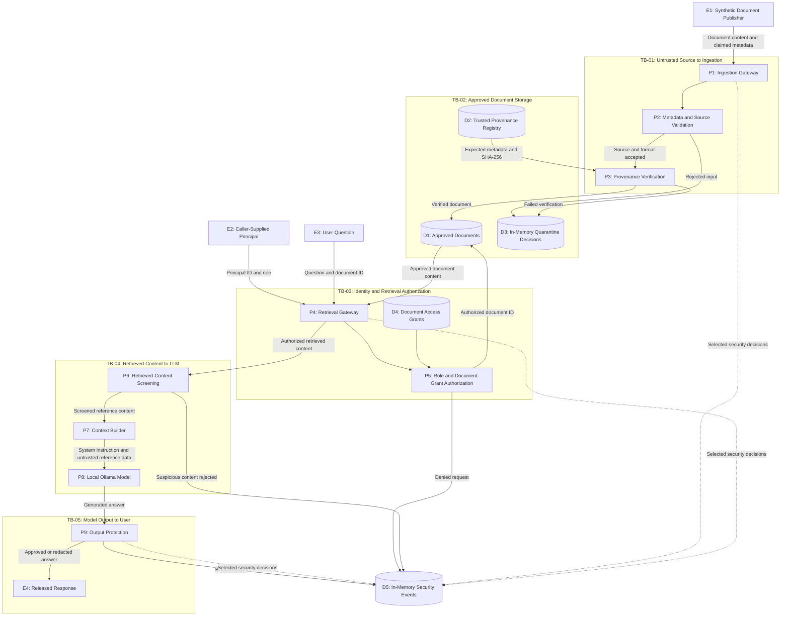

# Secure AI Data and RAG Pipeline — Data-Flow Diagram

## Purpose

This diagram represents the logical data flows, trust boundaries, and security decisions in the Project 5 synthetic RAG pipeline.

It distinguishes implemented laboratory controls from assumptions that would require stronger enforcement in a production environment.

## Data-Flow Diagram

## Trust Boundaries

| Boundary | Security concern | Implemented laboratory control |
|---|---|---|
| TB-01 | Untrusted documents entering the pipeline | Source allowlist and metadata validation |
| TB-02 | Integrity of approved document content | SHA-256 verification against provenance records |
| TB-03 | Unauthorized retrieval of classified documents | Role permissions and document-specific grants |
| TB-04 | Retrieved content influencing model instructions | Pattern-based screening and context separation |
| TB-05 | Disclosure through generated responses | Restricted-output blocking and synthetic identifier redaction |

## Security Assumptions and Limitations

- Publisher identity is not cryptographically authenticated.
- The provenance registry is mutable and maintained in memory.
- The principal identity and role are supplied by the caller; no independent authentication is implemented.
- Document grants are configured through an unauthenticated laboratory interface.
- Retrieval authorization is enforced by the demonstrated gateway, not by an independently secured storage layer.
- Prompt-injection screening is pattern-based and can be bypassed by novel or encoded payloads.
- The local model is not guaranteed to obey trust-boundary instructions.
- Security-event recording is selective, in memory, and not tamper-resistant.
- The diagram describes logical control flow, not independently isolated runtime services.

## Related Artifacts

- [System Architecture](../docs/architecture/system-architecture.md)
- [STRIDE Threat Model](../docs/threat-model/stride-threat-model.md)
- [MITRE ATLAS Mapping](../docs/atlas/atlas-mapping.md)
- [Security Evidence](../evidence/README.md)